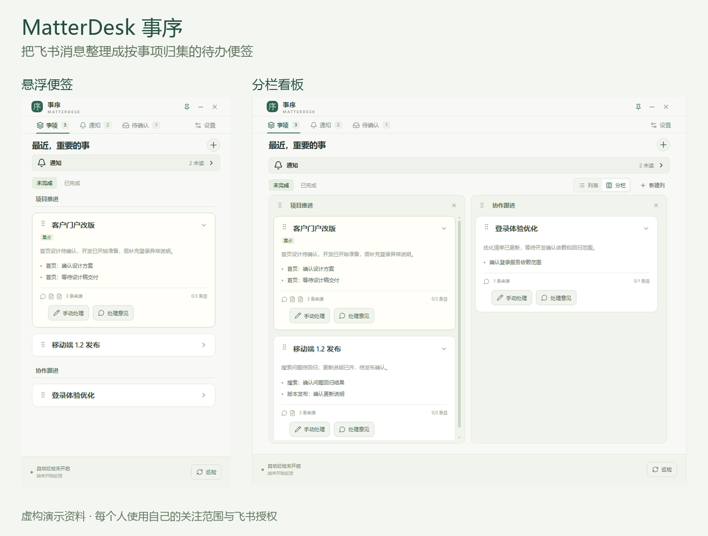
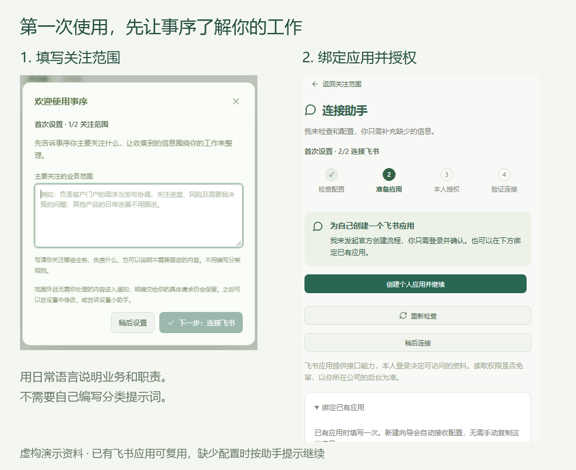

# MatterDesk · 事序

**把飞书里的讨论，整理成桌面上清楚的待办。**

群消息太多、同时跟进好几件事时，事序把散落的讨论放在同一事项下，帮你看清自己要做什么、还在等谁的反馈。

[开始使用](#开始使用) · [下载测试版](https://github.com/ThFoolL/matterdesk-releases/releases/tag/v0.21.0-beta.2) · [反馈问题](https://github.com/ThFoolL/matterdesk-releases/issues)



## 事序能帮你做什么

- **同一件事放在一起**：结合聊天上下文与相关云文档，把具体待办归到对应事项下，减少重复记录。
- **围绕你的工作整理**：按你关注的业务和职责，区分需要处理、需要跟进和只需知悉的内容。
- **随时看清进展**：桌面悬浮便签可以展开为分栏看板；待办保留消息时间和来源，方便回到飞书核对。
- **用对话调整分类**：告诉 Agent “这几条是一件事”或“这类工作不用我跟进”，让后续整理更符合你的习惯。
- **定时检查新信息**：连接飞书后，可以随时检查，也可以按自己的节奏开启定时更新。临时想到的事项也能手动添加。

## 开始使用

当前测试版支持 **Windows 10/11（64 位）**，可以从下面三个 Agent 使用：

| Agent | 使用要求 |
| --- | --- |
| Codex | 支持插件的桌面应用，已配置可用的模型 API 接口 |
| Claude Code | 支持插件，已配置用户级模型 API 接口或环境变量 |
| DeepSeek Harness（DSH） | 0.2.2-rc.1，Node.js 24.9 或更新版本，已连接模型 |

**同一台电脑共用同一份事项、待办、规则和飞书连接。** 已装 Codex 版时，安装另外一个入口即可继续使用，不需要重复绑定飞书。安装新入口会保留已有模型选择；需要切换时，在设置中选择“模型配置来源”。

已有旧版时，先让原 Agent 更新事序，再添加其他入口。

### 1. 让 Agent 帮你安装

把下面这段话复制到你使用的 Agent 对话中：

```text
帮我安装并初始化事序插件：
https://github.com/ThFoolL/matterdesk-releases
安装完成后，打开首次配置引导。
```

Agent 会按照这里的说明准备对应插件和桌面程序，安装在后台进行。首次安装后，Codex／Claude Code 新开会话加载事序工具；DSH 在插件页面关闭再开启事序一次。需要确认时，按宿主的提示继续即可。

### 2. 告诉事序你关注什么

在首次引导中，用日常语言说明主要关注的业务、职责，以及不需要跟进的内容。比如：“负责客户项目的需求和进度协调，关注风险与待确认的决定。”

接着按引导连接飞书：先确认有没有适合使用的应用，没有则推荐为自己新建。Agent 会处理能自动完成的配置，你只需必要的确认和本人授权；不会自动借用其他工具的应用。只申请需要的用户读取权限，云文档按需补充。优先走免审或应用开发者本人免发布的路径；消息搜索能否直接使用，以飞书后台和读取验证为准。



### 3. 放在桌面，开始跟进

连接完成后，点击“巡检”整理信息，或在设置中开启定时更新。

**首次安装完成后，事序默认随已启用插件的 Agent 启动，以后不用每次输入启动口令。** Codex 随桌面应用启动，Claude Code 在会话开始时启动，DSH 在插件加载时启动。可以在设置中关闭这个选项，也可以通过桌面快捷方式或托盘打开窗口。

首次配置可以稍后继续；也可以先跳过飞书连接，手动记录事项和待办。

<details>
<summary>其他安装方式</summary>

可以[下载完整安装包](https://github.com/ThFoolL/matterdesk-releases/releases/download/v0.21.0-beta.2/MatterDesk-0.21.0-beta.2-win-x64.zip)，解压后双击 `install.cmd`，选择使用的 Agent，再按窗口中的引导完成设置。无需管理员权限。选择 DSH 时，这一步只安装桌面程序；插件按下方方式添加。

如果需要手动安装 Codex 插件，在 PowerShell 中依次执行：

```powershell
codex plugin marketplace add ThFoolL/matterdesk-releases --ref main
codex plugin add matterdesk@matterdesk-codex
```

Claude Code：

```powershell
claude plugin marketplace add ThFoolL/matterdesk-releases
claude plugin install matterdesk@matterdesk-claude --scope user
```

DeepSeek Harness：在插件页按 Git 来源添加本仓库的 `plugin-dsh` 目录，或让 Agent 在你当前使用的 profile 中执行：

```powershell
dsh plugin --profile <当前使用的profile> add "git+https://github.com/ThFoolL/matterdesk-releases.git#main&path:/plugin-dsh"
```

安装后告诉 Agent“帮我初始化事序并打开配置引导”。DSH 使用的是较新预发布接口，请先确认版本符合上表要求。

</details>

## 使用前了解这几点

- **模型配置**：首次安装沿用当前 Agent 的配置，可分别选择主力和高速模型。Codex／Claude Code 需要已有 API 配置，仅订阅登录暂不能用于自动整理。选择 DSH 作为模型来源时，需要保持它运行；密钥留在 DSH 内，由它处理模型请求。
- **飞书范围**：读取范围由你的应用权限、本人授权和所选聊天、文档共同决定。事序只读取资料，不代你发送消息或修改云文档。
- **个人数据**：消息、待办和个人设置保存在本机；整理时，相关内容会发送到你使用的模型服务。配置导出不包含登录信息。详见[数据说明](PRIVACY.md)。
- **分享与更新**：可以把这个页面发给同事，每个人独立设置和授权。需要更新时，告诉 Agent“帮我检查并更新事序”；已保存的事项和个人设置会保留。同机共享支持三个入口同时使用，暂不支持跨设备同步。

当前为测试版，可免费用于个人和公司内部工作。图片中的内容均为演示示例。[查看使用许可](BINARY-LICENSE.txt)
